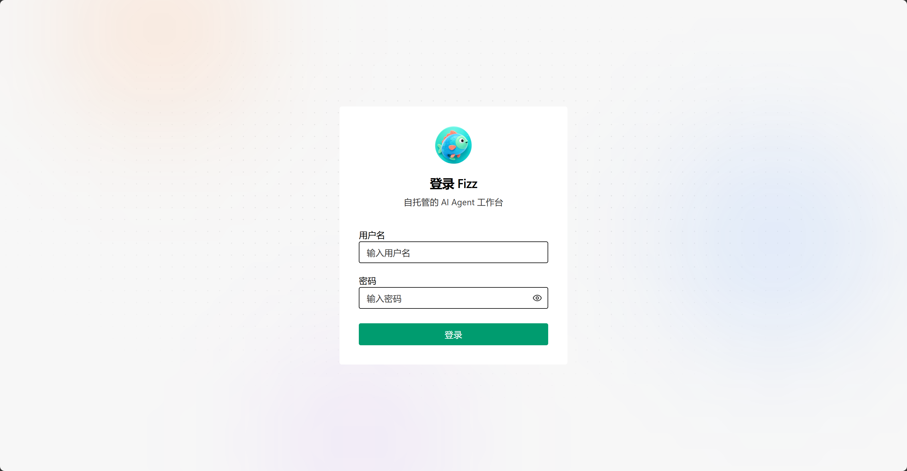
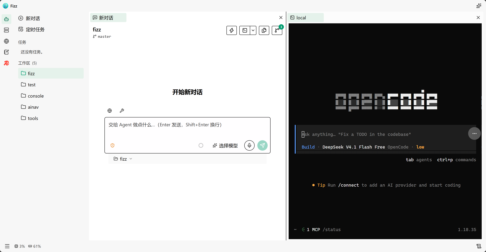
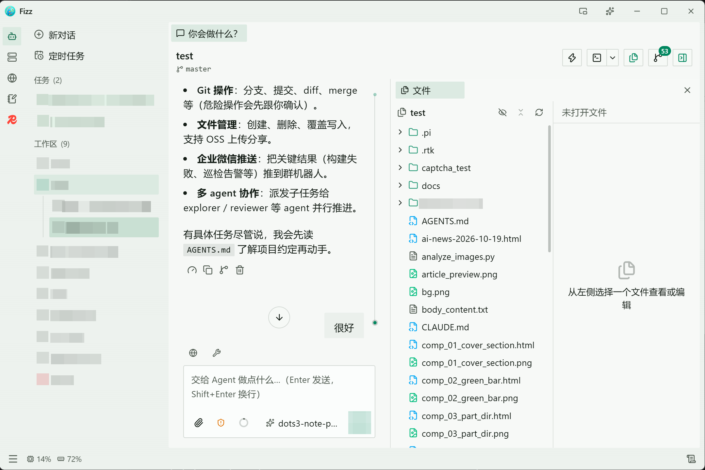
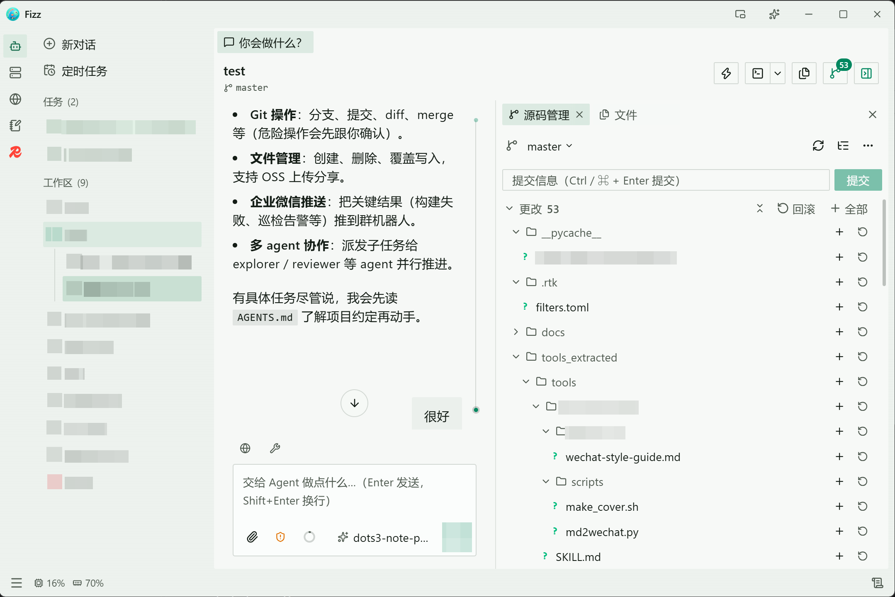
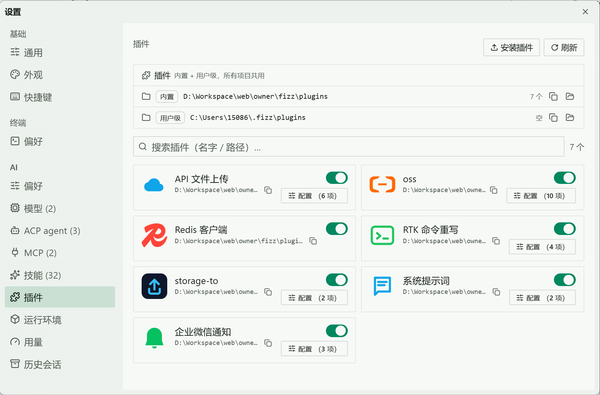
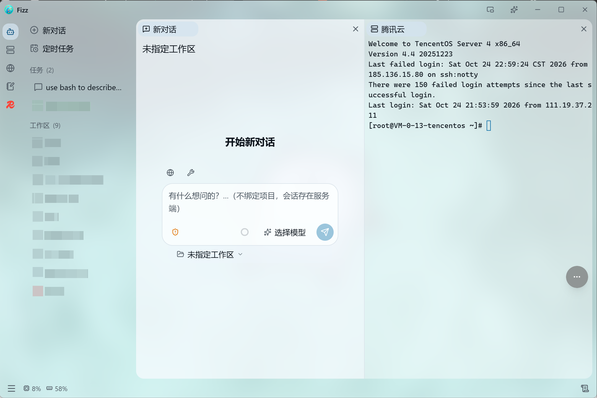
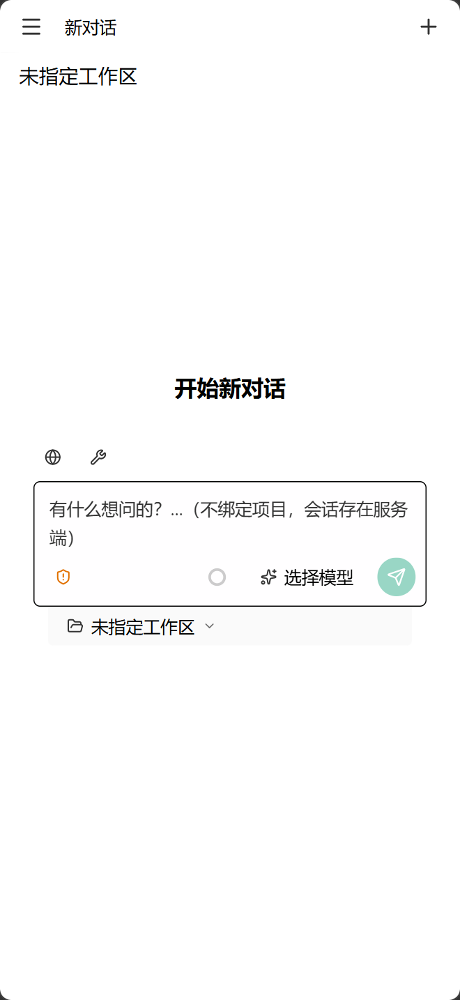
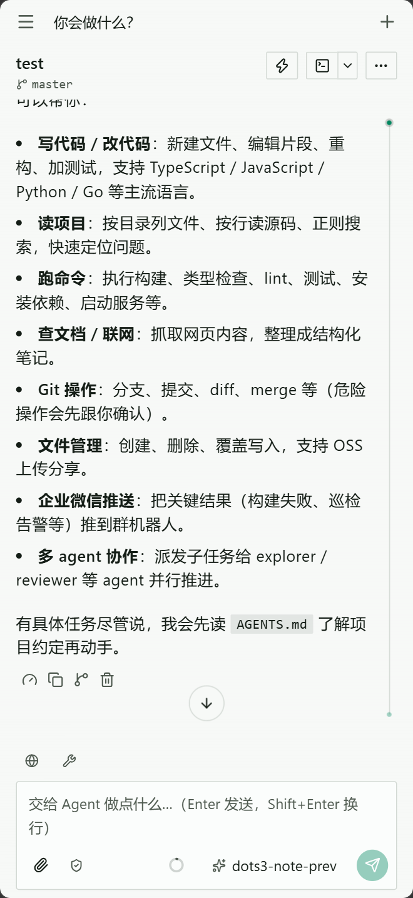

<div align="center">


**关注公众号「AI实习生」** · 聚焦前沿 AI 资讯，每日精选行业动态与技术实践

</div>

# Fizz

**自托管的 AI Agent 工作台。**

把 Fizz 部署在一台机器上，你或同事用浏览器打开对应网址就能和 AI 对话，让它读代码、改文件、跑命令、管 Git、连服务器——不需要在每台电脑上装客户端。

所有能力跑在**一个 Node 进程**里：HTTP 接口、SSE 对话流、Web 页面、终端（PTY）、SSH / SFTP 全部同源提供，部署只需要一个端口。除网页版外还提供 **Electron 桌面端**（把同一个 server 装进进程内跑）和 **Capacitor 安卓端**。

> **部署形态提示**：「容器型项目」需要 `docker run` 起新容器并挂宿主机真实路径，所以要求 server 跑在**宿主机**上。用主 Docker 容器跑「工作区 / 会话 / 终端 / 主机 / 后台任务」完全正常，容器型项目会如实显示「docker 不可用」，不影响其他功能。

---

## 功能特性

### 对话与智能体

- **多模型接入**：OpenAI、Anthropic、Google、DeepSeek，以及任意 OpenAI 兼容网关（可配 baseURL / 模型列表 / 思考内容解析）。模型可在会话内随时切换。
- **工具能力**：读文件、写文件、编辑、删除、列目录、搜文件、搜内容、执行命令、Git 只读视图、联网抓取、截图、浏览器操作（Playwright）、主动追问。AI 想动文件或跑命令时**先问你**，你点同意它才动手。
- **三档权限**：`确认模式`（默认，改动前询问）/ `只读模式`（只看不改）/ `完全访问`（不问直接执行）。另有工具调用并发、命令审批超时、请求重试等细项，都在「设置 → AI → 偏好」。
- **子任务（Subagent）**：把「只读、产出噪声大、与主上下文无关」的活派给独立 agent（`explorer` 侦察 / `reviewer` 审查）。子 agent 只拿到只读工具白名单，可指定更便宜的模型，带空闲看门狗防卡死。
- **多智能体协作画布**：在主智能体之外挂若干可配置子 Agent，画布上实时显示各节点状态、任务与消息；节点位置与连边即协作配置。
- **上下文管理**：接近预算时自动压缩历史（摘要 + 检查点），也可在上下文指示条上手动点「压缩上下文」；压缩后原始消息一条不丢，清除检查点即回到全文。
- **会话操作**：分叉（从某条消息签出新会话，可顺手建 git worktree）、重命名、归档、搜索（标题 + 正文，归档会话照搜）、把外部 agent 侧已有会话导入绑定、把 ACP 会话转成内置 Agent 会话继续聊。
- **富媒体输入**：拖入图片 / PDF 直接交给模型；语音输入（按住 `Alt+V` 说话）；回复里的 Markdown 文档自动挂成可点击产物。
- **实时流式**：SSE 推送思考过程、工具调用与正文，带应用层心跳；断线可用 `requestId` 续接同一轮。

### 项目与工作区

- **文件面板**：文件树浏览、Monaco 编辑器读写、多标签、未保存标记。图片 / SVG、音视频、Markdown、HTML 有内置预览（Markdown 与 HTML 可切源码 / 预览）。
- **源代码管理**：分支切换 / 新建、改动树、逐文件 diff、暂存与还原、提交、推送、历史记录。回滚有策略保护。
- **终端**：真正的 PTY 终端（`node-pty`），支持命令补全建议、ZMODEM 上传下载、手机端扩展键位。
- **worktree**：在项目下按分支拉独立工作树（`<项目>/.worktree/<标识>`），登记成新项目，互不干扰。
- **容器型项目**：每个项目一个独立容器，AI 的所有操作都在容器内；目录由服务端按随机 slug 生成。内置运行环境：Node.js 24、PHP 8.5、Go 1.27、Node + Vite/React/Tailwind、Node + Next.js/Tailwind。后两种 Web 栈镜像自带模板与自动启动，新建完打开就有页面。
- **预览与对外发布**：容器内 dev server 的端口映射到本机预览面板；需要公网时把项目挂到 `*.<域名>` 下（独立监听端口 + 显式「对外发布」开关）。
- **脚本**：把常用命令存成带分组、带描述的脚本，选一台主机或本地直接跑。
- **后台任务**：克隆仓库这类耗时活儿登记成后台任务——关掉页面也照跑，状态栏可看进度、展开日志、取消或转后台。日志逐行记录（含外部命令原文），是「还活着吗 / 为什么失败」的唯一解释。

### 日常工具与运维

- **SSH 主机**：多主机清单与分组、加密保存凭据（密码 / 私钥 / 口令）、一键在终端里连上，状态栏实时显示焦点主机的 CPU / 内存 / 磁盘 / 负载 / uptime。
- **SFTP**：远端文件浏览与上传下载（分片串行传输，同名覆盖）。
- **SSH 隧道**：本地转发（`-L`）、远程转发（`-R`）、动态 SOCKS5 代理（`-D`），起停状态由服务端推送。
- **接口请求**：内置 HTTP / WebSocket 客户端，支持分组、历史、cURL 导入、OpenAPI 导入，可当日常调试工具用。
- **笔记**：登记若干目录，每个目录一棵 Markdown 树，可读可写（接口先做路径校验，未登记目录一律 403）。
- **应用日志**：按命名空间（SSH / 终端 / 隧道 / 插件…）分页查看全 App 业务事件。
- **导入导出**：主机、接口请求、脚本可导出成 zip 或单文件 JSON，换机器时导入（按 id 覆盖，导入前先预览）。凭据加密绑本机，**不随包带走**，导入后需重填。
- **用量统计**：跨会话 token 汇总（按天柱状图 + 最费的会话榜），只统计跑完的轮次。

### 扩展与自动化

- **技能（Skills）**：放一份 `SKILL.md` 进技能目录即可被发现。支持内置（随包分发）、项目级、用户级（`~/.fizz/skills`）、跨智能体共享（`~/.agents/skills`）。系统提示词里只放名称与描述，正文由模型按需读取。
- **插件（Plugins）**：TS 源码直接加载的插件框架，能注册工具、系统提示词片段、设置项、上传源、模型、Hooks，以及**自己的活动栏图标与 UI 面板**。随包内置 7 个：OSS 存储、API 文件上传、Redis 客户端、storage-to、企业微信通知、RTK 命令重写、系统提示词。
- **MCP**：挂载任意 MCP 服务器，把它的工具接进对话。
- **外部 Agent（ACP）**：通过标准协议接入 Claude Code、Codex 等，支持一键探测本机已安装的 agent；外部 agent 会话也能在同一个界面里继续聊。
- **项目规则注入**：工作区根目录的 `AGENTS.md`（`CLAUDE.md` 兼容）每轮**全文**进系统提示词，支持行内 `@相对路径` 导入；全局规则放 `<配置目录>/AGENTS.md`；子目录的规则在模型读到该目录时按需追加。
- **定时任务**：cron 表达式（5 段）或一次性定时（`at`）触发一轮会话，内置进程内调度器，不依赖外部服务；任务可不绑工作区（每次运行新建临时工作区），每轮跑出的会话都留在侧栏可回看。

### 多端与界面

- **三端同源**：web / 桌面 / 安卓共用同一套 `agent-kit` 外壳与状态层，差异只在宿主能力与版式（手机版是**单标签 + 无活动栏**：顶栏一条、侧栏固定为会话列表抽屉、内容整屏铺满）。
- **桌面端增强**：托盘常驻、会话浮窗（贴边小窗，可置顶、可跳回主窗口）、应用内自动更新（只静默检查，下载与安装都要你点）、局域网远程访问（把进程内 server 暴露成真实端口，手机 / 其他浏览器直连）。
- **安卓端**：独立 vite 工程 + Capacitor 壳，服务端地址在登录页填写并存本机，同一个 APK 可连不同服务器。
- **界面自定义**：明暗模式、内置配色主题、自定义主题（逐项改色）、主题背景（图片或视频）、可拖拽排序的活动栏与面板分屏。
- **中英双语**：中文为源文案与默认语言，英文缺失项自动回落，不会出现空白。

### 安全

- **登录鉴权**：用户名 + 密码换服务端签发的 JWT（默认 30 分钟），HTTP 走 `Authorization: Bearer`，WS 走 `?token=`。三项配置齐全才启用；不配就是开发态全放行。
- **滑块验证码**：鉴权启用时默认开启，进程内现画拼图，答案只留内存，校验轨迹耗时。零外部依赖。
- **登录限流**：按 IP 滑动窗口（默认 60 秒 10 次），超限返回 429 + `Retry-After`。
- **密钥加密落盘**：API Key / 主机凭据用 AES-256-GCM（`SecretBox`）加密，主密钥来自 `FIZZ_SECRET_KEY` 或数据目录的 `secret.key`。
- **视图不含明文**：模型配置对外只给 `hasApiKey`，容器 Agent 只给 `envKeys` 列表；主机导出包不带密码与私钥。

---

## 界面一览

整个界面是「活动栏 + 侧边栏 + 主区域标签页 + 状态栏」四层（手机版是单标签，没有活动栏）：

| 区域 | 内容 |
| --- | --- |
| **活动栏**（最左，手机版没有） | AI Agent、主机、接口请求、笔记，以及插件自己声明的图标。顺序可拖拽 |
| **侧边栏** | 当前功能区的清单：会话 / 工作区树、主机与终端、请求分组与历史、笔记目录 |
| **主区域** | 多标签页：会话、文件、源码管理、终端、预览、笔记、脚本、定时任务、隧道、日志、协作画布，可拖拽分屏 |
| **状态栏**（底部） | 左侧全局菜单（命令面板 / 导入导出 / 断开连接 / 设置），右侧随上下文变化：后台任务徽标、本机与焦点 SSH 主机的资源监控、日志入口、更新提示 |

常用入口：右上角按钮展开 / 收起右侧面板；`Ctrl/Cmd + Shift + P` 打开命令面板，工作区、会话、视图开关、搜索会话、跑脚本、看日志都在里面；主题与背景在「设置 → 外观」。

### 登录

部署完第一次打开就是登录页：用户名 + 密码换服务端签发的令牌。没配鉴权（或桌面端直连本机 server）时跳过这一页，直接进工作台。



### 首页 · 会话与工作区

左侧是「新对话 / 定时任务 / 任务 / 工作区」清单，中间直接下指令（`Enter` 发送，`Shift+Enter` 换行），右侧可以并排开终端、文件、源码管理等标签页——下图右边就是一个连着服务器的终端。底部状态栏实时显示服务端的 CPU 与内存占用。



### 工作区 · 文件

点开工作区里的文件就能在 Monaco 里读写，图片 / SVG、音视频、Markdown、HTML 有内置预览。右侧面板与会话并排（可拖拽分屏），边聊边改；顶栏右侧那排按钮是快捷功能、终端、分屏、文件面板等入口。



### 工作区 · 源码管理

分支切换、提交信息、改动文件树、逐文件暂存 / 还原、提交，全在浏览器里完成；顶部还有刷新、推送、回滚与「全部暂存」。下图是 53 个待提交改动的真实场景。



### 设置

设置按「基础 / 终端 / AI」分组：通用、外观、快捷键；模型、外部 Agent、MCP、技能、插件、运行环境、用量、历史会话都在这一层。下图是插件页——内置与用户级两个插件目录，每个插件有独立开关和「配置 N 项」。



### 桌面端

桌面端是 Electron 壳 + 进程内 server：自绘标题栏（右上角是窗口控制与设置入口），主题背景（图片 / 视频）会透到整个窗口，另外还有托盘常驻与会话浮窗。下图右侧是一个连着 SSH 主机的终端。



### 手机端

安卓壳是单标签形态：顶栏一颗抽屉、一颗新建，侧栏是会话列表，内容整屏铺满。对话、工具卡、模型切换与桌面端是同一套。

<p>
  
  
</p>

---

## 快速开始

### 方式一：Docker（推荐，跑工作台本体）

```bash
cp .env.example .env          # 至少填上鉴权三项
docker compose up -d --build  # 首次启动或改过代码后
docker compose logs -f        # 启动日志里有访问地址与鉴权状态
docker compose down           # 停止（数据卷保留）
```

浏览器打开 `http://<服务器IP>:7801`，输入 `.env` 里的用户名密码登录。

容器里已装好 Git，第一次提交前给容器一个提交身份（写进持久化的 `/data`，重建不丢）：

```bash
docker compose exec fizz git config --global user.email "you@example.com"
docker compose exec fizz git config --global user.name  "你的名字"
```

> **鉴权三项必须一起配**：`FIZZ_AUTH_USER` / `FIZZ_AUTH_PASS` / `FIZZ_JWT_SECRET`，缺任何一项都等于「谁都能直接用」。

### 方式二：本地直接运行

> Windows 需要先装 C++ 编译工具链——终端功能依赖原生模块 `node-pty`。

```bash
npm install
npm run build:server
npm run build:web
npm run server      # 等价于 build:server && node apps/server/dist/index.js
```

打开 http://127.0.0.1:7801 。server 会同源托管构建好的网页，不需要配 CORS。

开发模式（两个终端）：

```bash
npm run dev:stack   # 构建 server + web 并启动 server
npm run dev:web     # 另开一个终端：vite dev server（5173，/api 已代理到 7801）
```

### 方式三：桌面端

```bash
npm run dev:desktop     # 开发模式（Electron + 进程内 server）
npm run pack:desktop    # 免安装目录
npm run dist:desktop    # 当前平台安装包（另有 dist:win / dist:mac / dist:linux）
```

桌面端数据目录与网页版隔离（`userData/server-data`），首次打开先配一个模型就能用。

### 方式四：安卓端

```bash
npm run add:android --workspace @fizz/mobile   # 新机器第一次必须先跑
npm run build:mobile                          # 构建 + cap sync
npm run android:build                         # 出 APK
```

APK 首次登录必须填服务端绝对地址（页面 origin 是 `https://localhost`），填完存本机，换服务器不用重装。

---

## 基本使用

1. **配模型**：设置 → AI → 模型，填 provider、API Key、模型名（OpenAI 兼容网关还要填 baseURL）。
2. **建工作区**：侧栏「新建工作区」选一个目录（Docker 部署时填容器内路径 `/workspace`）。也可以从 Git 克隆、新建 worktree，或建一个容器型项目。
3. **开聊**：直接描述要做的事，例如「帮我看看最近一次提交改了什么」「把这个函数的命名改规范」。需要动文件或跑命令时会弹确认卡片。
4. **边聊边改**：右侧面板切「文件 / 源码管理 / 终端」，改完让 AI 复核，或直接让它提交。
5. **调权限**：设置 → AI → 偏好，按信任程度在「只读 / 确认 / 完全访问」之间切。
6. **固化习惯**：把项目规矩写进 `AGENTS.md`，把常用流程写成 `SKILL.md`，把重复任务挂成定时任务。

---

## 快捷键

全部可在「设置 → 快捷键」里改。macOS 上 `Ctrl/Cmd` 显示为 `⌘`。

| 快捷键 | 作用 |
| --- | --- |
| `Ctrl/Cmd + Shift + P` | 命令面板 |
| `Ctrl/Cmd + Alt + S` | 设置 |
| `Ctrl/Cmd + Alt + B` | 打开 / 关闭侧边栏 |
| `Ctrl/Cmd + Alt + N` | 新建会话 |
| `Ctrl/Cmd + Alt + E` | 打开 / 关闭工作区文件 |
| `Ctrl/Cmd + Alt + G` | 打开 / 关闭源代码管理 |
| `` Ctrl/Cmd + Shift + ` `` | 打开 / 关闭终端 |
| `Ctrl/Cmd + Alt + L` | 切换亮 / 暗主题 |
| `Ctrl/Cmd + W` | 关闭当前标签（仅桌面端，浏览器会拦这个组合） |
| `Ctrl/Cmd + Shift + Enter` | 推送（焦点在源代码管理面板时） |
| `Ctrl/Cmd + S` | 保存当前文件（文件面板内） |
| `Alt + V` | 语音输入（按住说话） |

---

## 配置

配置写在项目根目录的 `.env`（照 `.env.example` 抄）。server 启动时读一次：**真实环境变量优先**，`.env` 只补还没设的项——容器注入的值不会被文件里的旧值顶掉。

### 鉴权与安全

| 变量 | 说明 | 默认 |
| --- | --- | --- |
| `FIZZ_AUTH_USER` | 登录用户名（三项齐全才启用鉴权） | 不设置则免登录 |
| `FIZZ_AUTH_PASS` | 登录密码 | 同上 |
| `FIZZ_JWT_SECRET` | JWT 签名密钥，`openssl rand -base64 32` 生成 | 同上 |
| `FIZZ_TOKEN_TTL` | 登录令牌有效期（分钟） | `30` |
| `FIZZ_AUTH_CAPTCHA` | 滑块验证码，鉴权启用时默认开；`0` 关闭 | 开 |
| `FIZZ_RATE_LIMIT` | 登录限流；`0` 关闭 | 开 |
| `FIZZ_LOGIN_RATE_MAX` / `FIZZ_LOGIN_RATE_WINDOW_SEC` | 限流阈值 | `10` 次 / `60` 秒 |
| `FIZZ_SECRET_KEY` | 加密 API Key 的主密钥（32 字节 base64） | 自动生成到数据目录 |
| `FIZZ_CAPTCHA_*` | 验证码尺寸、容差、有效期、签发限流等细项 | 见 `.env.example` |

> 登录令牌**不绑定 IP**（IP 会随网络漂移造成无谓掉线），改为短有效期 + 服务端校验签名，换网络不用重新登录。

### 服务与路径

| 变量 | 说明 | 默认 |
| --- | --- | --- |
| `FIZZ_HOST` | 监听地址 | `127.0.0.1`（容器内需 `0.0.0.0`） |
| `FIZZ_PORT` | 监听端口 | `7801` |
| `FIZZ_DATA_DIR` | 配置 / 会话 / 密钥存放目录 | `~/.fizz-server` |
| `FIZZ_CONFIG_DIR` | 全局规则目录（读其中的 `AGENTS.md` / `CLAUDE.md`） | `~/.config/fizz` |
| `FIZZ_WEB_DIR` | 同源托管的网页产物目录 | `apps/web/dist` |
| `FIZZ_CORS_ORIGINS` | 允许的跨域来源，逗号分隔（同源部署不需要） | 放行本地 5173 / 5175 / 5178 / 5180 与 Capacitor origin |
| `FIZZ_PUBLIC_BASE_URL` | 给模型的附件 URL 对外前缀 | 取请求 origin |
| `FIZZ_UPLOAD_BACKEND` | 附件存储后端 | `local` |
| `FIZZ_SKIP_ENV_FILE` | 设为 `1` 时不读 `.env`（端到端验证用） | 不设置 |
| `TZ` | 时区 | `Asia/Shanghai` |

### 模型与任务

| 变量 | 说明 | 默认 |
| --- | --- | --- |
| `FIZZ_CONTEXT_BUDGET` | 上下文兜底窗口（token），模型自己配了窗口的以模型为准 | `200000` |
| `FIZZ_SUBAGENT_IDLE_TIMEOUT_MS` | 子任务空闲看门狗，超时中止本轮；`0` 关闭 | `120000` |
| `FIZZ_CONTAINER_WAKE_TIMEOUT_MS` | 冷启动等容器内 Agent 就绪的上限 | `60000` |

### 项目与容器

| 变量 | 说明 | 默认 |
| --- | --- | --- |
| `FIZZ_PROJECTS_ROOT` | 「新建项目」弹窗的默认落点 | `<数据目录>/projects` |
| `FIZZ_CONTAINER_PROJECTS_ROOT` | 容器型项目根（每个项目一个随机 slug 子目录） | `<数据目录>/containers` |
| `FIZZ_CONTAINER_IMAGE_<ENV>` | 覆盖某个环境镜像 tag（`NODE` / `PHP` / `GOLANG` / `VITE` / `NEXTJS`） | 内置 `fizz/agent-*:latest` |
| `FIZZ_PUBLIC_HTTP_PORT` | 容器预览的公网入口端口；不设 = 不对外 | 关闭 |
| `FIZZ_PUBLIC_IP` | 设置页「解析到」显示的地址 | 本机第一个非回环 IPv4 |

### Docker Compose 专用

| 变量 | 说明 |
| --- | --- |
| `FIZZ_WORKSPACE` | 宿主机上给 AI 操作的目录，容器里挂成 `/workspace` |
| `FIZZ_SSH_DIR` | 宿主机 `.ssh` 目录（只读挂载，用 SSH 形式的 git 远端时需要） |
| `PUID` / `PGID` | 容器内运行身份，填宿主机 `id -u` / `id -g` |

### Docker 数据卷

- `fizz-data` → `/data`：配置、会话历史、加密后的 API Key、Git 全局配置
- `fizz-home` → `/home/fizz/.fizz`：自己加的技能目录（不挂载则重启丢失）
- `./workspace` → `/workspace`：AI 能读写的目录。**注册工作区时填容器内路径 `/workspace`**，不是宿主机路径——网页端的「选择文件夹」浏览的是 server 的文件系统

### 用宿主机身份写文件（可选）

设 `PUID` / `PGID` 后，容器里新建的文件在宿主机上属于你本人，Git 也不会再报 `dubious ownership`。记得把工作区目录也改成同一属主：

```bash
sudo chown -R $(id -u):$(id -g) /srv/my-project
```

---

## 项目结构

`packages/*` 按能力拆分，`apps/*` 是各个端：

| 路径 | 职责 |
| --- | --- |
| `packages/contracts` | 共享领域类型 + HTTP/SSE 契约 |
| `packages/workspace` | 存储、会话真源、各领域业务逻辑 |
| `packages/agent` | 模型解析、agent 循环、对话编排、子任务、协作运行时 |
| `packages/tools` | Agent 工具集（文件 / 命令 / 抓取 / 截图 / 浏览器 / Git 只读） |
| `packages/skills` / `plugin` / `mcp` / `acp` | 技能发现、插件框架、MCP、外部 Agent 客户端 |
| `packages/git` / `shells` | worktree 操作、本机 shell 探测 |
| `packages/agent-client` | 能力层：请求、传输、宿主契约（零 React） |
| `packages/agent-kit` | 三端共用的界面外壳、功能区与业务面板（React） |
| `packages/ui` / `ui-tokens` / `i18n` | 组件库、设计令牌、中英文案 |
| `packages/agent-host` | server 直连 + PTY / SSE 桥（桌面端专用） |
| `apps/server` | Hono 服务端：HTTP + SSE + WebSocket，同源托管网页 |
| `apps/web` | 浏览器端 |
| `apps/desktop` | Electron 壳：托盘、浮窗、自动更新、局域网远程访问 |
| `apps/mobile` | Capacitor 安卓壳（独立 vite 工程） |
| `docker/container-project` | 容器型项目的镜像定义与容器内 Agent 运行时 |

---

## 常用命令

| 命令 | 作用 |
| --- | --- |
| `npm run dev:stack` / `npm run dev:web` | 本地开发（server / 前端） |
| `npm run dev:desktop` / `npm run dev:mobile` | 桌面端 / 安卓端开发 |
| `npm run build:server` / `npm run build:web` | 构建服务端 / 网页 |
| `npm run server` / `npm run restart` | 构建并启动 / 重启本地服务 |
| `npm run build:desktop` | 构建桌面端三份产物（main / preload / renderer） |
| `npm run pack:desktop` / `npm run dist:desktop` | 免安装打包 / 安装包 |
| `npm run build:mobile` / `npm run android:build` | 安卓构建与同步 / 出 APK |
| `npm run typecheck` | 全量 TypeScript 类型检查 |
| `make up` / `make down` / `make logs` | Docker 快捷命令 |

---

## 部署形态与限制

| 场景 | 说明 |
| --- | --- |
| **主 Docker 容器** | 工作区、会话、终端、主机、接口请求、笔记、后台任务都正常。镜像里没有 docker CLI，所以「容器型项目」不可用 |
| **宿主机直跑**（`npm run server`） | 全部功能可用，包括容器型项目（需要本机有 docker） |
| **桌面端** | server 跑在进程内，等于「宿主机直跑」，但数据目录独立；可通过「远程访问」把后端暴露成局域网端口给手机用 |
| **安卓端** | 只是客户端，必须连一个 server（地址登录时填） |
| **公网访问** | 需单独启用 `FIZZ_PUBLIC_HTTP_PORT`，DNS 泛解析到本机，自备反代在 443 终结 TLS 并透传 `Host` 与 WebSocket 升级 |

**鉴权是单账号模型**：一个用户名 + 一个密码，适合个人或小团队共用一台机器，不提供多用户与权限隔离。对外暴露时请务必配上鉴权，并在前面加一层 HTTPS 反代。

---

## 致谢

[linux.do](https://linux.do)
